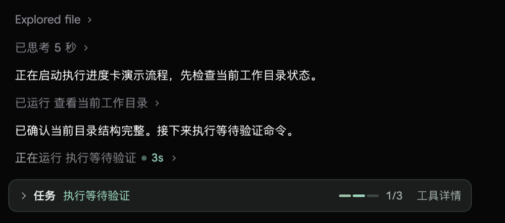

# Antigravity 执行进度

在 Antigravity 桌面版的原聊天中查看 Agent 的阶段汇报、任务进度、工具调用和耗时。安装包还提供一个独立的「Antigravity 中文」入口，用同一份官方 App 启动中文界面。

[最新版本与发布说明](https://github.com/hou3301-byte/antigravity-agent-progress/releases/latest)



## 功能

| 功能 | 使用效果 |
| --- | --- |
| 边做边汇报 | 多步骤任务中，Agent 用简短消息交代当前发现和下一步。连续的短调用可以合并汇报，简单问答直接回答。 |
| 流内任务清单 | 三个及以上阶段的任务，或明确要求展示进度时，默认只显示一行当前阶段和完成数。展开后可查看各项状态。完成或停止后收成可回看的摘要。 |
| 完整步骤与工具详情 | 默认展开本轮的 `Worked for` 等原生步骤分组，可以手动收起。工具调用保留在原对话里，点「工具详情」可展开本轮输出。 |
| 前台与后台计时 | 前台在原生工具行上读秒。工具转入后台后，状态区显示运行中的后台任务数和耗时。 |
| 中文界面和中文规则 | 「Antigravity 中文」入口用本地 CDP 翻译界面控件。简体中文规则插件可以独立开关。 |

阶段汇报由插件规则引导。流内任务卡、工具行读秒和步骤自动展开由本项目的「Antigravity 中文」入口提供。它启动官方 App，通过仅监听本机的 CDP 渲染界面增强。监视进程随该次 App 会话退出。

## 安装

需要 macOS、已安装的 [Antigravity App](https://antigravity.google/download) 和可用的 `/usr/bin/python3`。v0.5.0 已在 Antigravity 桌面版 2.34.0 上实测。运行以下命令为当前用户的所有项目安装进度插件、中文规则和中文入口。

```bash
(
  set -o pipefail
  curl -4 -fsSL --connect-timeout 5 --max-time 15 \
    https://raw.githubusercontent.com/hou3301-byte/antigravity-agent-progress/v0.5.0/install.sh | bash
)
```

`-4` 让脚本下载走 IPv4，可避开部分网络访问 `raw.githubusercontent.com` 时的 IPv6 超时。连接超时为 5 秒，脚本下载总时限为 15 秒。启动安装脚本后，发布包由 `codeload.github.com` 另行下载。安装完成时，终端会打印「卸载入口」及其路径。

可以在上面命令的 `bash` 后追加以下选项。以下三种模式都只安装插件。

| 用法 | 命令后缀 |
| --- | --- |
| 只装进度插件与中文规则 | `-s -- --plugins-only` |
| 只装进度插件 | `-s -- --progress-only` |
| 只为指定项目装插件 | `-s -- --workspace "/完整项目路径"` |

全局插件安装到 `~/.gemini/config/plugins/`，项目插件安装到项目内的 `.agents/plugins/`。如果本机已有有效的全局配置，安装器会登记 `verboseConversationSteps` 的原值并开启完整步骤展示。

如果脚本下载仍然超时，可以从 GitHub 克隆同一版本，再运行本地安装脚本。

```bash
git clone --depth 1 --branch v0.5.0 https://github.com/hou3301-byte/antigravity-agent-progress.git &&
  bash antigravity-agent-progress/install.sh
```

已克隆仓库时，也可以在对应版本的仓库根目录直接运行 `bash install.sh`。

## 使用

1. 保存工作并按 **⌘Q** 完全退出当前 Antigravity，再从 Finder 的「应用程序」打开「Antigravity 中文」。如果安装器无法写入 `/Applications`，可从个人的 `~/Applications` 打开。
2. 新建对话，发送「演示执行进度卡」，或选用 `/progress-card` 技能。演示会检查当前目录、等待 8 秒并核对结果。等待时可以看工具行计时，结束后可展开「已完成」摘要回看清单。
3. 日常可以直接交给 Agent 一个多阶段任务，或在任务里加一句「执行过程中展示进度卡」。要停用某个规则插件，在「自定义 → 已安装」选择对应插件并禁用。

点「任务」可展开或收起任务清单，点「工具详情」可切换本轮原生工具输出。焦点在输入框外时，也可分别用 `Ctrl+T` 和 `Ctrl+O`。点击停止后，任务区会标记「已停止」，已完成项仍可展开查看。

如果本机已有同名的第三方「Antigravity 中文」入口，安装器会复用旧入口。若要使用本项目的任务卡和工具行计时，请按旧入口自己的卸载方法移除它，再重新安装本项目。

## 升级

直接重新运行新版安装命令即可升级由安装器登记且未在本机修改的插件，再按 **⌘Q** 退出并重新打开「Antigravity 中文」。如果安装提示进度插件未登记或已修改，先按提示备份并移走对应目录，再重新安装。

## 一键卸载与回退

推荐直接运行安装器留在本机的卸载脚本，可离线使用。

```bash
bash ~/.gemini/config/antigravity-agent-progress-install/uninstall.sh
```

也可以在线卸载。

```bash
(
  set -o pipefail
  curl -4 -fsSL --connect-timeout 5 --max-time 15 \
    https://raw.githubusercontent.com/hou3301-byte/antigravity-agent-progress/v0.5.0/uninstall.sh | bash
)
```

- 想预览卸载范围，在线命令以 `bash -s -- --dry-run` 结尾。本机脚本末尾可直接加 `--dry-run`。
- 按项目安装时，本机卸载脚本位于项目的 `.agents/antigravity-agent-progress-install/uninstall.sh`，运行时加上 `--workspace "/完整项目路径"`。在线卸载则以 `bash -s -- --workspace "/完整项目路径"` 结尾。
- 卸载会停止本包启动的监视器，移除本包管理的启动入口和插件，并恢复安装时登记的完整步骤设置。修改过的插件会移动到备份目录，终端会显示路径。
- 卸载完成后，按 **⌘Q** 退出当前会话，再点击官方 Antigravity 图标，即可恢复原版界面。
